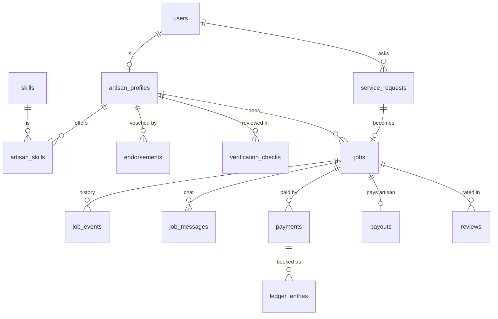

# ACbridge database folder

Everything here is **simulated demo data**: no real people, phone numbers or money. Demo password for every seeded account: `Demo-Pass-123!`.

## What is in this folder

| File | What it is |
|---|---|
| **`browse.html`** | **Start here.** Double-click it. Every table and view on a tab, with row counts and a search box. Read-only, no install. |
| `acbridge.db` | The real database file (SQLite) with the **same tables as the backend** (`backend/app/models.py`). Open it with any SQLite tool. |
| `schema.sql` | The `CREATE TABLE` statements: the structure of every table, constraints and indexes. |
| `views.sql` | Ready-made views that join tables so they read like reports (see below). |
| `csv/` | One CSV file per table and view. Open in Excel (UTF-8). |
| `make-browser.mjs` | Regenerates `browse.html` from any `.db` file. |
| `build-demo-db.mjs` | Turns data you create **in the browser demo** into its own database (see "Data from the browser demo"). |

## Ways to open `acbridge.db`

1. **`browse.html`**: nothing to install.
2. **DB Browser for SQLite** (free, https://sqlitebrowser.org): File, Open Database, pick `acbridge.db`. Use "Browse Data" and "Execute SQL".
3. **VS Code**: install the extension *SQLite Viewer* (or *SQLite*), then click `acbridge.db`.
4. **Node.js** (you already have it, version 22.5 or newer):
   ```bash
   node --no-warnings -e "const {DatabaseSync}=require('node:sqlite'); const d=new DatabaseSync('database/acbridge.db',{readOnly:true}); console.table(d.prepare('SELECT * FROM v_ledger_balances').all())"
   ```

## How the data is organised

There is **no "organisation" table**: the platform has one operator team and no companies. The data is organised in five groups:



| Group | Tables |
|---|---|
| **Accounts and artisans** | `users` (customers, artisans, verifier, administrator), `artisan_profiles`, `skills`, `artisan_skills`, `endorsements` (vouches), `verification_checks` |
| **Customer requests and jobs** | `service_requests` (trade, place, budget, **urgency**), `jobs` (offer, prices, status), `job_events` (history), `job_messages` (the "connect flexibly" chat), `reviews` |
| **Payments** | `payments` (customer payments), `payouts` (the artisan's share: PENDING, HELD, PAID), `webhook_events` |
| **Money ledger** | `ledger_entries` (double entry: for every `tx_key` the DEBIT lines equal the CREDIT lines), `audit_log` (money events and operator actions as hashes) |
| **Refunds** | `hardship_claims` |

Passwords are stored only as Argon2id hashes (`users.password_hash`); `browse.html` shortens them.

## Ready-made views (start with these)

| View | Shows |
|---|---|
| `v_accounts` | every registered account (role, phone, artisan name) |
| `v_artisans` | artisans with trade, price, verification status and endorsement count |
| `v_customer_requests` | each customer request with urgency, the chosen artisan, the job status and prices |
| `v_payments` | payments with artisan and payer phone |
| `v_payouts` | the artisans' shares and whether they are pending, held or paid |
| `v_ledger_balances` | collection, platform revenue, artisan pending, artisan paid |
| `v_chat` | the bargaining messages |

## What the demo data contains

Built by playing complete stories through the real API (`backend/scripts/build_database.py`):

- **Grace (plumber), customer Mary:** bargained in the chat (the artisan stated the final 6,000 FCFA), paid, finished, payout PAID, rated 5.
- **Paul (electrician), customer Joseph:** paid 12,000 FCFA, work in progress, payout PENDING.
- **Ngu Peter (electrician), customer Aline:** paid 8,000 FCFA, work finished but the **operator held the payout** with a reason.
- **An expired offer:** an urgent plumbing request the artisan did not accept within the hour (job CANCELLED, event `JOB_OFFER_EXPIRED`).
- **An offer still waiting:** Aline asked Paul, a bargaining chat is in progress.
- **An open request** with no artisan chosen yet (carpentry), and a **new artisan** (John Fon) with two endorsements and a skill check waiting for the verifier.
- Commission is 5% (300 FCFA minimum) cut from the customer's payment: ledger `platform_revenue` 1,300, `artisan_paid` 5,700, `artisan_pending` 19,000, `collection` 26,000 (balanced).

Useful queries:

```sql
SELECT * FROM v_customer_requests;                       -- who asked for what, and what happened
SELECT * FROM v_payments;                                -- every payment
SELECT * FROM v_ledger_balances;                         -- the money split
SELECT tx_key, account, direction, amount FROM ledger_entries ORDER BY tx_key;
SELECT event_type, created_at FROM job_events WHERE job_id = '<job id>' ORDER BY created_at;
```

## Data from the browser demo

The browser demo (`acbridge.html`) keeps its data in your browser (localStorage), not in a file. To see what **you** created there (artisan sign-ups, vouches, requests, chats, payments, ledger):

1. In the demo open the **Operator** screen (PIN `1234`) and press **Export data**. A file `acbridge-demo-data.json` is downloaded (password hashes are not included).
2. Run: `node --no-warnings database/build-demo-db.mjs path/to/acbridge-demo-data.json`
3. Open `database/demo-from-browser.html` (double-click) or `database/demo-from-browser.db` in a SQLite tool. CSVs are in `database/csv-from-browser/`.

These generated files are ignored by git.

## Rebuilding `acbridge.db`

It is a snapshot. To rebuild it with fresh data you need Python 3.11+ and the backend requirements:

```bash
cd backend
pip install -r requirements.txt
python scripts/build_database.py          # rewrites ../frontend/database/*
cd ../frontend && npm run db:browse        # regenerates browse.html
```

Notes: this is a **SQLite copy for viewing**. The real backend runs on PostgreSQL (`DATABASE_URL`), so the production database lives on your server, not in this folder. Do not store real personal data here.
